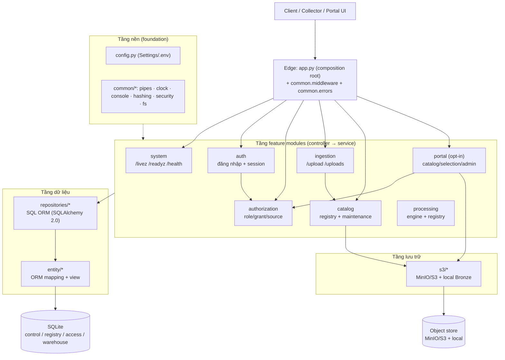
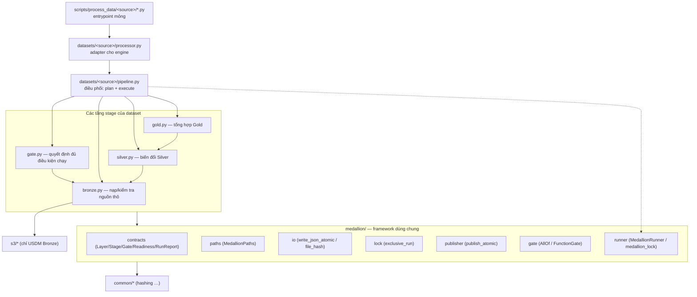

# SƠ ĐỒ KIẾN TRÚC PHÂN TẦNG — Server `climate-platform`

> Cập nhật: 2026-11-24 · Phạm vi: `src/climate_platform/` (trục App/HTTP và trục Pipeline dữ liệu) và `scripts/process_data/`.
> Nguồn bằng chứng: đọc trực tiếp mã nguồn (`file:line`), grep import, không chỉnh sửa file nào.

Repo có **hai trục phân tầng độc lập**, dùng chung tầng nền `common/` và tầng lưu trữ `s3/`:

- **Trục A — App/HTTP (request path):** phục vụ đọc/ghi qua HTTP (upload collector, Portal, system probe).
- **Trục B — Pipeline dữ liệu (medallion):** biến đổi Bronze → Silver → Gold theo lô, chạy qua CLI/worker, không cần HTTP.

---

## 1. Trục A — App / HTTP (request path)

### 1.1 Sơ đồ tầng

### 1.2 Nhiệm vụ mong đợi của từng tầng (sạch)

| Tầng | Nhiệm vụ đơn | Phụ thuộc hợp lệ |
|---|---|---|
| Edge (`app.py`, `common/middleware`, `common/errors`) | Dựng app, middleware, exception filter, include router | xuống mọi tầng (composition root) |
| Foundation (`config`, `common/*`) | Cấu hình + tiện ích thuần | chỉ stdlib |
| Controller (`modules/*/controller*`) | Nhận HTTP, gọi service, trả DTO | → service |
| Service (`modules/*/service*`, `portal/services/*`) | Nghiệp vụ + điều phối | → repository + storage |
| Repository (`repositories/*`) | Chỉ SQL ORM trên entity | → entity + DB |
| Entity (`entity/*`) | Ánh xạ ORM khai báo | → SQLAlchemy |
| Storage (`s3/*`) | I/O đối tượng (publish/verify/list) | → driver (boto3/local) |

Trên "happy path", thứ tự `controller → service → repository → entity/DB` và `service → s3 → object store` được tôn trọng.

---

## 2. Trục B — Pipeline dữ liệu (medallion)

### 2.1 Sơ đồ tầng

### 2.2 Nhiệm vụ mong đợi của từng tầng

| Tầng | Nhiệm vụ đơn | Ghi chú |
|---|---|---|
| Entrypoint (`scripts/process_data/`) | Gọi CLI/runner, không chứa science | phải "thin" |
| `processor.py` | Adapter mỏng cho `processing.engine` | không science |
| `pipeline.py` | Chỉ điều phối: plan → lock → gọi stage → ghi report | không science, không policy |
| `gate.py` | Quyết định đủ điều kiện, không side-effect dữ liệu | theo `contracts.Gate` |
| `bronze.py` | Đọc/kiểm tra nguồn thô (read-only) | |
| `silver.py` | Biến đổi + publish artifact Silver | 1 artifact |
| `gold.py` | Tổng hợp + publish artifact Gold | 1 artifact |
| `medallion/*` | Framework dùng chung, mỗi module 1 việc | datasets chỉ dùng, không sửa |

### 2.3 Đối chiếu mức tuân thủ giữa các dataset

| Tiêu chí | NOAA | NLDAS | USDM | USGS |
|---|---|---|---|---|
| Đúng layout `spec/paths/validation/bronze/gate/silver/gold` | ✔ | ~ (thiếu `validation`) | ✘ | ✘ |
| Dùng `medallion.paths.MedallionPaths` | ✔ | ✔ | — (không có `paths`) | ✘ (tự viết lại) |
| Dùng `medallion.publisher` | ✘ | ✘ | ✔ | ✘ |
| Dùng `medallion.runner.MedallionRunner` | ✘ | ✘ | ✘ | ✘ |
| `Gate` đúng protocol và có được dùng | định nghĩa nhưng **không dùng** | **sai protocol** | **không có** | hàm, có dùng |
| Stage import chéo stage | không | không | — | ✔ nhiều |
| Stage tự gọi lại gate | không | không | — | ✔ |
| Có tầng ngoài Bronze/Silver/Gold | không | không | không | **Weekly + Preprocess** |
| Có producer ngoài pipeline | không | không | không | **`fill_gold.py`** |

Xếp hạng độ "sạch" tầng: **NOAA > NLDAS > USDM > USGS**.

---

## 3. Kiểm tra nguyên tắc "mỗi tầng chỉ làm đúng một việc"

Kết luận ngắn: **có vi phạm**, tập trung ở tầng dữ liệu/lưu trữ (trục A) và ở tầng pipeline/stage (trục B). Controller, entity, `processing` và medallion core thì sạch.

### 3.1 Vi phạm nghiêm trọng — Trục A (App)

| # | Vị trí | Vi phạm | Bằng chứng |
|---|---|---|---|
| A1 | `repositories/*`, `s3/local_repository.py` | Tầng dữ liệu/lưu trữ **import FastAPI và raise `HTTPException`** → vừa lưu trữ vừa xử lý HTTP | `repositories/access_repository.py:12,72,76`; `repositories/database.py:22,86-87`; `repositories/catalog_repository.py:72,101,115,125`; `s3/local_repository.py:10,27,36` |
| A2 | `modules/catalog/service.py` | Service **tự chạy SQL + transaction + gọi S3** (kiêm cả repository) | `:13-18,82-84,118,127-146` (chạm `repo._state` private) |
| A3 | `modules/portal/services/{catalog,admin,release}.py` | Service **truy vấn ORM trực tiếp**, bỏ qua repository | `catalog.py:15,187-201`; `admin.py:36-83,103-160`; `release.py:5,12-17` |
| A4 | `common/middleware.py` | Tầng nền **phụ thuộc ngược lên feature module** (`auth`) và xuống `access_repository`; một middleware làm 5 việc (gác path, xác thực, hạn mức, mô tả lỗi, audit) | `:20,30-68,75-90` |
| A5 | `modules/portal/services/selection.py` (~420 dòng) | Một service ôm: phân quyền + I/O file + băm checksum + lease + audit + stream + dựng HTTP header | `:251-264,276-293,325-354,356-419` |
| A6 | `modules/ingestion/service.py` | Service vừa stream + băm + tạo file tạm + validate + raise HTTP (kiêm cả storage/validation) | `:10,53-58,60-88,98-104,136-137` |

### 3.2 Vi phạm nghiêm trọng — Trục B (Pipeline)

| # | Vị trí | Vi phạm | Bằng chứng |
|---|---|---|---|
| B1 | `medallion/contracts.py` + `medallion/runner.py` | **Hợp đồng plugin "chết"**: `Stage`, `MedallionRunner`, `AllOf`, `FunctionGate`, `read_json` **không dataset nào dùng** → mỗi dataset tự viết lại plan/skip/lock | grep `datasets/**` không có kết quả dùng; pipeline tự viết vòng lặp: `noaa/pipeline.py:105-155`, `nldas/pipeline.py:116-148`, `usgs/pipeline.py:98-134`, `usdm/pipeline.py:65-96` |
| B2 | `usdm/science.py` | **Một file làm cả Silver lẫn Gold** (và quality) — không có tách tầng Bronze/Silver/Gold | `:77` ghi `silver.parquet`, `:92` ghi `gold.csv`, `:93-102` ghi `quality.json` (byte-pinned, đã chấp nhận nhưng vẫn là phá tầng) |
| B3 | `usgs/fill_gold.py` | **Producer Gold thứ hai, mồ côi** — không nối vào pipeline/processor/manifest/publisher | `:225-261` ghi gold bằng `to_parquet` (`:241`), tự khai lại `WINDOWS/LEVELS` |
| B4 | `usgs/weekly.py` + `usgs/manifest.py:74` | **Tầng thứ tư "Weekly" không khai báo**, ghi vào thư mục Silver nhưng tự nhận là `silver` | `weekly.py:61-95`; `manifest.py:74` |
| B5 | `usgs/silver.py` | Stage **tự gọi lại gate** (`require_complete`/`audit_raw`) → bỏ qua tầng gate chạy 2 lần | `:68-70` (pipeline cũng gọi `conditions_met` ở `pipeline.py:58`) |
| B6 | `usgs/gold.py` | Một file vừa **tạo** vừa **tự kiểm chứng lại toàn bộ** bảng Gold (build + verify) | `:123-158` (`gold()`) và `:161-339` (`validate_gold`, 178 dòng) |
| B7 | `usgs/weekly.py`, `usgs/silver.py`, `usgs/paths.py` | **Import chéo stage** và **tự viết lại paths/checksum** thay vì dùng tầng dùng chung | `weekly.py:16` → `silver.validate_daily`; `silver.py:19,22-27` → `preprocess`; `paths.py:11-29` bỏ `MedallionPaths` |

### 3.3 Vi phạm mức trung bình (cả hai trục)

| # | Vị trí | Vi phạm |
|---|---|---|
| M1 | `repositories/catalog_repository.py:112-171` | Repository chứa policy dedup/revision + tự đặt object vào storage (kiêm service) |
| M2 | `repositories/access_repository.py:43-100` | Repository quyết định hạn mức và raise HTTP 429/503 |
| M3 | `repositories/auth_repository.py:90-96,116-147` | Repository tự xác thực mật khẩu + policy hết hạn session |
| M4 | `repositories/control_repository.py:36-165` | `Store` vừa facade vừa repository, kèm policy eviction/rate-limit/lease |
| M5 | `repositories/releases.py:38-67` | Repository chứa workflow activate + snapshot SQLite thô |
| M6 | `modules/portal/middleware.py:28-114` | Mega-middleware: request-id, demo, session, CSRF, body cap, rate limit, lease, header, audit |
| M7 | `modules/portal/module.py:22-64` | Wiring module làm cả bootstrap DB, đăng ký handler, mount static, shell route |
| M8 | `modules/catalog/maintenance.py:18-190`, `s3_maintenance.py:19-179` | Trộn migration + reconcile + backup + SQL + I/O + report trong một module |
| M9 | `modules/catalog/maintenance.py:33-36` | Import chéo module `catalog → ingestion.validation` (rủi ro chu trình) |
| M10 | `modules/portal/services/publish.py:40` | Service tổng quát phụ thuộc dataset cụ thể `datasets.usdm.processor` |
| M11 | `config.py:140-186,239-246,249` | Config vừa cấu hình vừa I/O vừa chứa policy phân quyền, lại singleton toàn cục |
| M12 | `modules/system/readiness.py:13-17,30-77` | Probe vượt tầng, chạm ORM/DB/boto3 trực tiếp và trộn policy compliance (versioning/SSE-KMS/Object-Lock) |
| M13 | `nldas/gate.py:15-26` | `Gate` trả tuple sai protocol và tự lọc tuần (lấn việc planning) |
| M14 | `nldas/bronze.py:17-23,31,46-80` | Tầng Bronze ôm 4 việc rời (parse arg, walk fs, tính readiness, validate calendar) |
| M15 | `noaa/silver.py:212-383`, `noaa/gold.py:197-227` | File biến đổi ôm cả skip/orchestration + governance artifact + tự ghi `to_parquet`/`to_csv` (bỏ publisher) |
| M16 | `usgs/gold.py:19,321-323` | Gold phụ thuộc `manual_comparison.json` do bước export ngoài pipeline tạo |
| M17 | `scripts/process_data/noaa/crawl_noaa_cpc.py` (266 dòng) | Entrypoint "mỏng" lại chứa crawler đầy đủ, trùng sự thật với `noaa/spec.py` |

### 3.4 Mẫu lỗi tổng hợp

| Mẫu vi phạm | Nơi xuất hiện | Mức |
|---|---|---|
| HTTP/FastAPI rò xuống tầng dữ liệu & lưu trữ | `repositories/*`, `s3/local_repository.py` | Cao |
| Service kiêm repository (SQL/transaction) | `catalog/service.py`, `portal/services/{catalog,admin,release}.py` | Cao |
| Phụ thuộc ngược (nền → feature module) | `common/middleware.py` | Cao |
| Mega-service / mega-middleware | `portal/services/selection.py`, `portal/middleware.py` | Cao |
| Service kiêm storage/streaming/validation | `ingestion/service.py` | Cao |
| Hợp đồng plugin medallion không được dùng | `medallion/{contracts,runner,gate}.py` | Cao (trục B) |
| Một file làm nhiều tầng medallion | `usdm/science.py`, `usgs/gold.py` | Cao (trục B) |
| Tầng/Producer không khai báo, mồ côi | `usgs/weekly.py`, `usgs/fill_gold.py` | Cao (trục B) |
| Repository chứa business policy | `catalog_repository`, `access_repository`, `auth_repository`, `control_repository`, `releases` | Trung bình |
| Wiring module ôm bootstrap/static/handler | `portal/module.py` | Trung bình |
| Import chéo module / package→dataset | `catalog/maintenance.py`, `portal/services/publish.py` | Trung bình |
| Config kiêm I/O + policy | `config.py` | Trung bình |
| DTO transport nằm trong package `entity/` | `entity/view.py` → `ingestion/{controller,dto}.py` | Thấp |
| CLI package import `scripts/*` | `cli.py:63-74` | Thấp |

### 3.5 Tầng sạch (đối chiếu)

- `entity/*` (base/registry/access/control/warehouse) — ORM khai báo thuần, không logic.
- `modules/processing/{contracts,engine,module}.py` — biên Strategy/Plugin đúng: dataset được đăng ký, không rẽ nhánh `if dataset`.
- `modules/auth` tách bạch với `modules/authorization` (xác thực ≠ phân quyền).
- `modules/portal/controllers/*` — controller mỏng, chỉ delegate.
- `s3/minio_repository.py` — raise lỗi driver/`ValueError`, **không** raise HTTP (đây là mẫu chuẩn cho `s3/local_repository.py`).
- `common/{clock,console,hashing,security,pipes}.py` — tiện ích một việc.
- `modules/portal/workers/read_worker.py` — SQL thô là ngoại lệ **được phép** theo `AGENTS.md`.
- `medallion/{contracts,paths,io,lock,publisher,gate,runner}.py` — bản thân mỗi module một việc (vấn đề là **độ phủ**, không phải hướng phụ thuộc).
- `scripts/process_data/{nldas,noaa,usgs}/run_*.py`, `usdm/run_usdm.py` — entrypoint mỏng.

---

## 4. Kết luận

1. **Kiến trúc hiện tại là 2 trục phân tầng:** trục App/HTTP (`controller → service → repository → entity` + `s3`) và trục Pipeline medallion (`entrypoint → processor → pipeline → stage(bronze/silver/gold) → medallion core → io/paths`). Hướng phụ thuộc trên "happy path" đúng cả hai trục.
2. **Có vi phạm nguyên tắc "mỗi tầng một việc"**, rõ nhất ở:
   - Trục A: tầng dữ liệu/lưu trữ bị nhiễm HTTP (A1); service kiêm repository (A2, A3); nền `common` phụ thuộc ngược lên feature module (A4); 2 "mega-component" (`portal/middleware`, `portal/services/selection`) (A5, A6).
   - Trục B: hợp đồng medallion không được dùng (B1); `usdm/science.py` gộp Silver+Gold (B2); USGS có tầng Weekly ngầm + producer Gold mồ côi + stage import chéo + stage tự chạy lại gate (B3–B7).
3. **Ưu tiên sửa (không đổi hành vi, có test):**
   1. Gỡ FastAPI khỏi `repositories/*` và `s3/local_repository.py`; raise lỗi domain, map HTTP một lần ở `common/errors.py`.
   2. Đưa hết SQL trong service về repository (`catalog/service.py`, `portal/services/{catalog,admin,release}.py`).
   3. Sửa đảo phụ thuộc `common/middleware.py` → chuyển xác thực/accounting vào service của `auth`/`ingestion`.
   4. Tách `portal/middleware.py` và `portal/services/selection.py` thành các collaborator một việc.
   5. Trục B: áp `Stage`/`MedallionRunner`/`publisher` cho cả 4 dataset; xóa tầng "Weekly" ngầm và `usgs/fill_gold.py`; đưa `gate` của USGS về đúng protocol và bỏ việc stage tự chạy lại gate.
