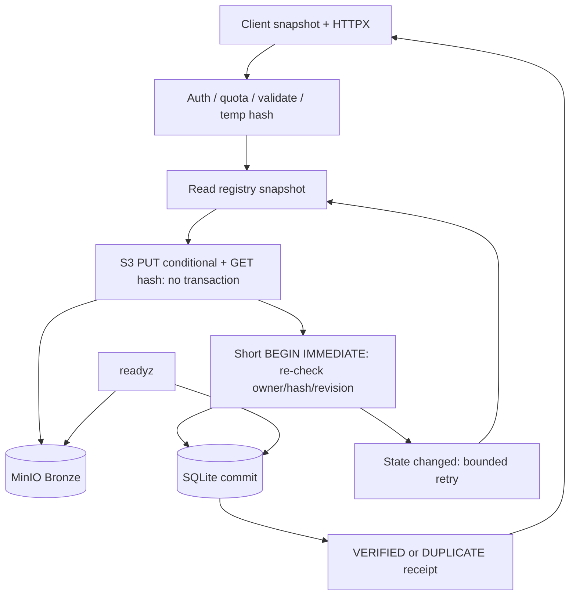

# Stage 1 — Baseline ingestion và triển khai

Nguồn chuẩn plan: [AGENT.md](AGENT.md). Rules/convention: [../../AGENTS.md](../../AGENTS.md).
Trạng thái tổng quát: **local có bằng chứng; clean deploy còn cần xác minh.**

## 1.1 Công việc và tiến độ baseline

| ID | Công việc | Trạng thái / bằng chứng | Điều kiện còn lại |
|---|---|---|---|
| S1.01 | API multipart, validate source/date/key/file, hash raw | DONE local: server + HTTP tests | Không đồng nghĩa kiểm định khoa học |
| S1.02 | SQLite observations/revisions/ownership/idempotency | DONE local: duplicate/revision/concurrent/fault tests | Theo dõi regression Stage 2 |
| S1.03 | Bronze local và S3 conditional publish/verify | Local DONE; S3 có smoke PASS lịch sử | Chạy lại real MinIO smoke với release hiện tại |
| S1.04 | Auth, rotating keys, source grants, quota/audit/readiness | DONE component tests | TLS hai máy và policy thật cần nghiệm thu |
| S1.05 | Migration/reconcile và giữ raw cũ | DONE local, S3 có bằng chứng lịch sử | Dùng snapshot backup chuẩn Stage 2 trước thao tác thật |
| S1.06 | Dockerfile/Compose/persistent volumes | Implemented, lịch sử local PASS | Official artifacts/clean deploy hiện tại NEEDS VERIFICATION |
| S1.07 | Ruff/unit/HTTP integration | Local PASS | Không dùng CI/CD; Client checkout cần release tương thích |

## 1.2 Phạm vi và công nghệ nền

Server nhận raw file khí hậu, kiểm tra bytes/kích thước, lưu Bronze và quản lý logical
observations/revisions. API dành cho một collector vật lý nhiều nguồn, với danh tính/quyền tách
khỏi metadata do người gửi cung cấp. Nền ingestion theo file đã được mở rộng bằng batch USDM
Silver/Gold/warehouse SQLite ở Stage 3 và Portal ở Stage 4. Chưa có stream processing hoặc
Warehouse đa nguồn.

- Python 3.11; FastAPI/Uvicorn, Pydantic v2/pydantic-settings, python-multipart; HTTPX và
  python-dotenv hỗ trợ công cụ/tests.
- SQLite chuẩn Python: registry `ingestion.sqlite3` và accounting `access.sqlite3`;
  boto3/botocore/s3transfer cho S3-compatible MinIO.
- Pin dependency trực tiếp (xem `pyproject.toml` / `requirements*.txt`): FastAPI 0.143.0,
  Uvicorn 0.54.0, Pydantic 2.14.0, pydantic-settings 2.15.0, HTTPX 0.28.1, boto3 1.40.72.
  Không coi venv đang có là bằng chứng clean install mọi pin thành công.
- Docker Compose: API, MinIO, init job. Kiểm tra local: Ruff/pytest/build/image
  verification/Compose smoke; không dùng CI/CD. Không có API worker ETL hay broker.

## 1.3 Chức năng và contract phải giữ khi nâng cấp

Phân loại dựa trên implementation và bằng chứng, không dựa trên tên thư mục. `Implemented`
không đồng nghĩa production-ready; `Unknown / Needs Verification` cho môi trường/hành vi chưa
nghiệm thu. Đường dẫn code theo package `src/climate_platform/` (xem
[../../docs/AGENT_MODULES.md](../../docs/AGENT_MODULES.md)).

| Trạng thái | Chức năng | Bằng chứng / giới hạn |
|---|---|---|
| Implemented | HTTP ingestion bốn source, sanitize filename, date/key/size validation, SHA-256 | `api/app.py`, `ingestion/service.py`; unit và HTTP loopback PASS. Không parse/kiểm định nội dung khoa học. |
| Implemented | Registry observation/revision/idempotency/ownership | `catalog/repository.py`, SQLite transactions và unique indexes; duplicate/concurrency/revision tests PASS. |
| Implemented | Local Bronze backend | Content-addressed files, atomic replace, kiểm tra duplicate raw; test hiện tại dùng backend này. |
| Implemented | S3 Bronze backend | `infrastructure/object_store.py`; conditional PUT, tải lại tính hash; smoke/fault scripts và báo cáo MinIO lịch sử, không chạy S3 thật lại trong phiên gần nhất. |
| Implemented | Authentication/authorization, key rotation/expiry/revocation | `api/access.py`, `api/security.py`, `config.py`; unit/component tests PASS. Static keys còn bật mặc định cho tương thích. |
| Implemented | Rate limit, quota bền vững, audit | Accounting SQLite theo key và identity, xác thực trước multipart, trả 429/Retry-After; test PASS. Chưa có central audit archive. |
| Implemented | Liveness/readiness và startup validation | `/livez`, `/readyz`, `/health` alias; SQLite probes và S3 probes; local và mock S3 tests PASS. |
| Implemented | Migration và reconciliation | JSON→SQLite; local→S3 dry-run/apply/backup; missing/corrupt/orphan reporting; local tests PASS, S3 có báo cáo lịch sử. Không tự khôi phục bytes đã mất. |
| Partially Implemented | Deployment tái lập | Dockerfile/Compose có; official digests phải cung cấp, clean build/Compose chưa xác minh gần đây. |
| Partially Implemented | Medallion storage | Init tạo bốn bucket private/versioned; chỉ Bronze có đường ghi S3 nghiệp vụ. Silver/Gold/warehouse SQLite local đã có ở Stage 3; Silver/Gold S3 chưa có. |
| Partially Implemented | SSE-KMS/Object Lock | Có flags và kiểm tra startup; không provision KMS/retention, không chứng minh dữ liệu cũ đã mã hóa/khóa. |
| Not Implemented | Thu thập upstream tự động | Bốn collector Client vẫn là skeleton; Server đã có historical replay USDM offline. |
| Implemented local | USDM Silver/Gold và warehouse SQLite | `datasets/usdm/*`; xem [Stage 3](STAGE_3_USDM.md). |
| Implemented local, Pending UAT | Data Portal | `api/portal/`, `../frontend-climate-platform/`; xem [Stage 4](STAGE_4_PORTAL.md). |
| Not Implemented | DuckDB/dbt, streaming broker/orchestrator, pipeline đa nguồn | Không suy từ USDM local thành hệ thống đa nguồn đã hoàn tất. |

### API contract với Client

| Endpoint | Input / response / quyền |
|---|---|
| `GET /livez` | Public, 200 `{"status":"ok","service":"climate-data-server"}`; không chứng minh dependency khỏe. |
| `GET /readyz` | Public, 200 `status=ok` hoặc 503 `status=unavailable`, Cache-Control no-store; cache nội bộ mặc định 3s. |
| `GET /health` | Alias readiness, đánh dấu deprecated; giữ để tương thích. |
| `GET /openapi.json`, `/docs`, `/redoc` | Schema/UI mặc định FastAPI; không phải API ingest khác. |
| `POST /upload` | `X-API-Key`; multipart bắt buộc `file`, `source`, `source_date`; tùy chọn `dataset_key`; collector được cấp source mới upload được, admin không có quyền upload theo policy hiện tại. |
| `GET /uploads?source=...` | `X-API-Key`; JSON list metadata, source filter tùy chọn. Collector chỉ xem record của mình trong source được phép; admin xem toàn bộ. Không phân trang, không chỉ lọc VERIFIED/current. |

Ingestion không có `/register`, `/verify`, `/ingest` hoặc SQL tùy ý. Portal có preview/map/download
riêng dưới `/api/portal/v1`, dùng username/password/session/grants. Client không gửi credentials; key quyết định
identity. `source` được strip/lower và thuộc `usdm/noaa/usgs/nldas`; date Server parse rồi chuẩn hóa
`YYYY-MM-DD`, Client kiểm tra format nghiêm ngặt trước khi gửi. File không rỗng, mặc định tối đa
**20 MiB**; middleware giới hạn toàn multipart body ở file limit + 1 MiB.

`dataset_key`: chuỗi ổn định theo product/station/indicator, tối đa 512 ký tự, không blank/control
characters; thiếu field dùng basename tên file chưa sanitize. `original_filename` trong metadata là
tên đã sanitize. Không dùng trực tiếp filename/dataset key để cho người gửi điều khiển storage path.

Upload thành công luôn HTTP 200 với `{status, message, metadata}`. Top-level `status=VERIFIED` hoặc
`DUPLICATE`; metadata của duplicate vẫn `status=VERIFIED`. `FileMetadata` có:

```text
file_id, client_id, source, source_date, dataset_key,
original_filename, stored_path, size_bytes, sha256, received_at,
revision, previous_file_id, is_current, error_message, status,
s3_bucket, s3_object_key, s3_version_id
```

- Observation duy nhất theo `(source, source_date, dataset_key, sha256)`, revision duy nhất theo
  `(source, source_date, dataset_key, revision)`; một current revision cho mỗi source/date/key.
- Cùng logical observation trả file_id cũ; bytes khác tạo revision mới và giữ raw cũ; retry revision
  cũ không đổi current. Identity khác chiếm dataset hiện có bị 403, không lộ metadata qua duplicate.
- Local backend có thể dùng chung blob theo SHA-256 giữa các observation. S3 dùng object riêng theo
  source/date/dataset/revision/hash; không khẳng định dedup vật lý toàn bucket theo hash.
- `stored_path` của upload S3 mới là `s3://bucket/key`; record migration có thể giữ đường local cũ và
  thêm S3 mapping. Cột S3 mới là thông tin phải dùng cho mapping S3, không suy luận chỉ từ stored_path.
- 400: source/date/key/file không hợp lệ; 401: key; 403: quyền/ownership; 413: size; 422: multipart
  validation; 429: rate/quota, có Retry-After; 503: storage/integrity/accounting unavailable; lỗi
  DB/I/O khác có thể 500.
- Client retry đúng `{408,429,500,502,503,504}` và một số lỗi transport; không chấp nhận 409 là
  duplicate. Client hiện chưa tôn trọng Retry-After.

## 1.4 Module và luồng hiện tại

| Module/thư mục | Trách nhiệm và dependency |
|---|---|
| `src/climate_platform/api/app.py` | FastAPI routes/lifespan, logging stdout; gọi access/security, readiness, ingestion, catalog. |
| `src/climate_platform/config.py` | Settings load lúc import từ `.env` tại working directory/OS env; validate keys, sources, S3 credentials, paths. Singleton dùng chung. |
| `src/climate_platform/api/access.py`, `api/security.py` | ASGI middleware auth trước body, accounting/audit; dependency identity và source/owner policy. |
| `src/climate_platform/ingestion/service.py`, `ingestion/validation.py` | Validate, sanitize, ghi temp theo chunk 1 MiB, fsync/hash; chuyển register sang threadpool. |
| `src/climate_platform/catalog/repository.py` | `FileMetadata`, registry, initialize schema tại startup/CLI, mapping/revisions/local và S3 registration hai pha. |
| `src/climate_platform/infrastructure/object_store.py` | Sinh object key; S3 client, conditional publish, GET/hash verify, list objects. |
| `src/climate_platform/infrastructure/readiness.py` | Read/write-rollback probes SQLite, HeadBucket runtime; startup kiểm tra versioning/private policy và optional KMS/lock. |
| `src/climate_platform/catalog/maintenance.py`, `catalog/s3_maintenance.py` | Migration có backup; reconcile ghi report và tùy chọn repair status; không xóa raw. |
| `src/climate_platform/processing/*` | DatasetProcessor strategy + registry, engine, publisher helper. |
| `scripts/` | backup/migration/reconcile/verify CLI; smoke qua HTTP/Compose; S3 fault assertions; image scan/SBOM; demo; test upload thủ công. |
| `data_lake/`, `metadata/`, `warehouse/` | Runtime local/legacy, temp, SQLite; `.gitkeep` không chứng minh có ETL. |
| `Dockerfile`, `Dockerfile.worker`, `compose.yaml`, `deploy/nginx.conf` | Packaging, volumes, MinIO init, biến thể deployment và mẫu reverse proxy TLS. |
| `tests/`, `docs/` | Unit/component/integration, contract và bằng chứng lịch sử. |



SQLite registry dùng WAL, synchronous FULL, foreign keys, connection ngắn theo operation;
`user_version=1` với additive migration ba cột S3. Tables: `content_blobs`, `observations`,
`recovery_reports`; partial unique index bảo đảm một current revision. `access.sqlite3` có table
`usage` với bucket `key:<id>` và `client:<id>`, fixed-window theo phút/ngày UTC; quota tính cả
multipart overhead và upload lỗi/retry.

S3 key hiện tại:

```text
source=<source>/year=<yyyy>/date=<source_date>/dataset=<sha256(dataset_key UTF-8)>/
revision=<n>/sha256=<content_sha256>/raw<safe_extension>
```

`IfNoneMatch="*"` ngăn adapter ghi đè; sau PUT hoặc khi object đã tồn tại luôn GET bytes để kiểm
tra SHA-256/size, không tin ETag/user metadata. SDK publish/verify cấu hình 3 total attempts,
connect 3s, read 10s. Stage 2 đã bỏ writer lock qua S3 I/O: đọc snapshot, publish/verify ngoài
transaction, rồi transaction ngắn re-check owner/hash/revision; tối đa 8 vòng cạnh tranh. Nếu
object đã ghi nhưng DB rollback có thể còn orphan: retry cùng mapping nhận lại sau verify;
reconciliation báo orphan, không tự xóa. Đây không phải distributed transaction tuyệt đối.

Startup gọi initialize schema qua threadpool, tạo accounting rồi validate dependencies; readiness
probe riêng không tự tạo lại DB mất. Probe S3 runtime chỉ HeadBucket, không phải test PutObject/GET
integrity. Cache và timeout áp dụng mỗi process/probe, không phải deadline tổng tuyệt đối.

### Deployment hiện có

- `compose.yaml`: API build từ source, chạy UID/GID 10001 qua Dockerfile; MinIO và mc từ namespace
  official theo digest bắt buộc; API chờ minio-init hoàn tất. API port 8000 và MinIO 9000/9001 chỉ
  bind loopback. API có CPU/memory/PID limits và healthcheck `/readyz`.
- Named volumes `registry → /storage/metadata`, `bronze → /storage/data_lake` (legacy/temp),
  `minio-data → /data`. Tên bronze volume không có nghĩa raw S3 nằm ở volume API đó.
- `scripts/ops/minio-init.sh`: bốn bucket private/versioned; dedicated ingestion user chỉ đọc/ghi source
  prefixes Bronze và kiểm tra bucket; không Delete/Silver/Gold/Warehouse. Không truyền root
  credentials cho API.
- `compose.yaml`: file Compose duy nhất; Internet deployment đặt `ENABLE_STATIC_KEYS=false` và
  `API_KEYS` hợp lệ. `deploy/nginx.conf` là mẫu host TLS, chưa provision certificate/host service.
- Demo/source dùng cùng `compose.yaml`, chọn image bằng `CLIMATE_API_IMAGE`, `MINIO_IMAGE`,
  `MINIO_MC_IMAGE` và pull policy tương ứng; xem README. Repo không chứa recipe xây hai image source.
  Quyền triển khai lịch sử không cấp quyền triển khai mới.

## 1.5 Bằng chứng baseline trước bản sửa Stage 2

Các số 47/59 dưới đây là kết quả lần audit baseline, không phải số test Server sau khi bổ sung
regression Stage 2. Stage 1 là Docker Compose/kiểm tra local trên nền Stage 0 reliability, không phải
hoàn tất toàn Data LakeHouse. MinIO được thêm sau baseline ban đầu.

| Gate / bằng chứng | Đánh giá hiện tại |
|---|---|
| Ingestion, auth, SQLite, revision, recovery | Implemented; local/component/HTTP tests PASS. |
| Phiên 2026-11-20: Server pytest | **47 passed, 1 warning, 23.55s**: 7 HTTP integration, 12 readiness/security, 7 object-key, 10 server, 11 stage15 tests. Backend test mặc định local; S3 readiness dùng mock. |
| Phiên đó: Client pytest | **59 passed**; dùng source Client sibling thực trong HTTP tests. |
| Phiên đó: Ruff check/format | PASS, **28 Python files** phía Server. |
| Docker build, Compose persistence, clean-source deploy | Ghi nhận lịch sử ngày 2026-11-15: PASS/Stage 1 local DONE ở phiên bản khi đó. Chưa chạy lại gần đây. |
| S3 thật, migration, outage/retry, restart/down-up | `MINIO_INTEGRATION_REPORT.md` ghi PASS lịch sử; có scripts kiểm tra. Không suy ra deployment hiện tại vẫn healthy. |
| Clean deploy của Compose mặc định hiện tại | **Needs Verification**: `.env.example` để trống MINIO_DIGEST/MINIO_MC_DIGEST có chủ đích; Compose yêu cầu artifacts được xác minh. |
| Image gate, hai máy HTTPS, load/restore drill | **Unknown / Needs Verification**; không chạy từ phiên documentation. Không dùng CI/CD. |

Lệnh thực chạy: `.venv/Scripts/python.exe -m pytest -q -p no:cacheprovider --basetemp <thư mục
TEMP riêng>` với `PYTHONDONTWRITEBYTECODE=1`; Ruff check/format dùng `--no-cache`. Chỉ dùng venv có
sẵn, không cài package hoặc khởi chạy Docker/migration thật. Warning thực tế: Starlette TestClient
dùng HTTPX bị deprecated; test vẫn PASS, không tự đổi sang httpx2.

**Kết luận Stage 1:** có bằng chứng lịch sử hoàn thành local và nền reliability vẫn qua test hiện
tại. Không xác nhận toàn bộ Stage 1 của working tree hiện tại đã hoàn thành vô điều kiện; còn tái
nghiệm thu clean deployment/official images/Compose. Không dùng kết quả local backend làm
bằng chứng MinIO production hoặc real-time SLA.
