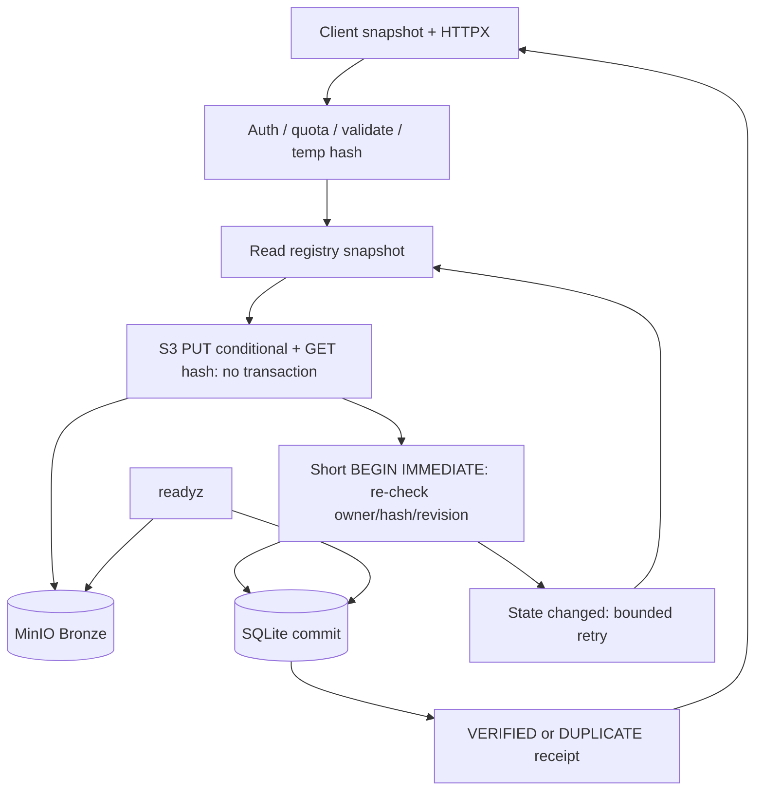

# AGENT.md — Tiến độ từng stage / Server climate-platform

Cập nhật: 2026-11-22 (Asia/Saigon). Repo này là **Server**; Client là `../climate-collector`.
Đây là sổ công việc để phiên sau tiếp tục, không phải danh sách stage đã hoàn thành mặc định.
Giữ ID task khi cập nhật; mỗi task phải ghi trạng thái, file ảnh hưởng, bằng chứng và phần còn thiếu.

**Quy ước:** DONE = code/docs và kiểm tra được nêu đã xong; PARTIAL = còn acceptance gate;
TODO = chưa làm; NEEDS VERIFICATION = chưa có kết quả trong môi trường cần thiết.
Không nâng PARTIAL lên DONE chỉ vì có source code hoặc test mock PASS.

| Stage | Phạm vi thực tế | Trạng thái |
|---|---|---|
| 1 | Baseline ingestion/queue, Bronze/registry, deployment/CI | Local có bằng chứng; clean deploy/remote CI còn cần xác minh |
| 2 | Củng cố backup/restore và SQLite/S3 transactions | PARTIAL: code/tests local xong; real MinIO restore/benchmark và lịch backup còn mở |
| 3 | USDM historical replay → Bronze → Silver → Gold/SQLite | DONE trong phạm vi USDM local phía Server; collector tự động Client vẫn TODO |
| **4** | **Data Portal xem/tải ba tầng, bản đồ và phân quyền** | **Implemented local — Pending UAT và nghiệm thu deployment** |
| **5** | **Checkpoint toàn pipeline và release CI bắt buộc GIS** | **PARTIAL: code/local tests xong; MinIO/Docker/remote CI/off-host còn gate** |
| 6 | Vận hành và mở rộng theo tải/SLO | TODO, cần workload và số đo |

Scope thực tế thay roadmap cũ: Stage 3 đã bao gồm cả Silver/Gold USDM;
Stage 4 là Data Portal. Các gate MinIO Stage 2 vẫn độc lập và chưa đóng.
Các số PASS Stage 1–4 là bằng chứng lịch sử; kiểm tra mới cho Stage 5 được ghi riêng bên dưới.

## Stage 1 — Baseline ingestion và triển khai

### 1.1 Công việc và tiến độ baseline

| ID | Công việc | Trạng thái / bằng chứng | Điều kiện còn lại |
|---|---|---|---|
| S1.01 | API multipart, validate source/date/key/file, hash raw | DONE local: server + HTTP tests | Không đồng nghĩa kiểm định khoa học |
| S1.02 | SQLite observations/revisions/ownership/idempotency | DONE local: duplicate/revision/concurrent/fault tests | Theo dõi regression Stage 2 |
| S1.03 | Bronze local và S3 conditional publish/verify | Local DONE; S3 có smoke PASS lịch sử | Chạy lại real MinIO smoke với release hiện tại |
| S1.04 | Auth, rotating keys, source grants, quota/audit/readiness | DONE component tests | TLS hai máy và policy thật cần nghiệm thu |
| S1.05 | Migration/reconcile và giữ raw cũ | DONE local, S3 có bằng chứng lịch sử | Dùng snapshot backup chuẩn Stage 2 trước thao tác thật |
| S1.06 | Dockerfile/Compose/persistent volumes | Implemented, lịch sử local PASS | Official artifacts/clean deploy hiện tại NEEDS VERIFICATION |
| S1.07 | CI/Ruff/unit/HTTP integration | Local PASS; workflow có | Remote CI chưa xác minh; Client checkout cần pin release tương thích |

### 1.2 Phạm vi và công nghệ nền

Server nhận raw file khí hậu, kiểm tra bytes/kích thước, lưu Bronze và quản lý logical observations/revisions. API dành cho một collector vật lý nhiều nguồn, với danh tính/quyền tách khỏi metadata do người gửi cung cấp. Nền ingestion theo file đã được mở rộng bằng batch USDM Silver/Gold/warehouse SQLite ở Stage 3 và Portal ở Stage 4. Chưa có stream processing hoặc Warehouse đa nguồn.

- Python 3.11; FastAPI/Uvicorn, Pydantic v2/pydantic-settings, python-multipart; HTTPX và python-dotenv hỗ trợ công cụ/tests.
- SQLite chuẩn Python: registry `ingestion.sqlite3` và accounting `access.sqlite3`; boto3/botocore/s3transfer cho S3-compatible MinIO.
- `requirements.txt` pin dependency trực tiếp; các phiên bản khai báo gồm FastAPI 0.143.0, Uvicorn 0.54.0, Pydantic 2.14.0, pydantic-settings 2.15.0, HTTPX 0.28.1, boto3 1.40.72. Không coi venv đang có là bằng chứng clean install mọi dependency pin thành công.
- Docker Compose: API, MinIO, init job; GitHub Actions: Ruff/pytest/build/image verification/Compose smoke. Không có API worker ETL hay broker.

### 1.3 Chức năng và contract phải giữ khi nâng cấp

Phân loại dựa trên implementation và bằng chứng, không dựa trên tên thư mục. `Implemented` không đồng nghĩa production-ready; `Unknown / Needs Verification` dùng cho môi trường hoặc hành vi chưa nghiệm thu.

| Trạng thái | Chức năng | Bằng chứng / giới hạn |
|---|---|---|
| Implemented | HTTP ingestion bốn source, sanitize filename, date/key/size validation, SHA-256 | `main.py`, `ingestion.py`; unit và HTTP loopback PASS. Không parse/kiểm định nội dung khoa học. |
| Implemented | Registry observation/revision/idempotency/ownership | `metadata.py`, SQLite transactions và unique indexes; duplicate/concurrency/revision tests PASS. |
| Implemented | Local Bronze backend | Content-addressed files, atomic replace, kiểm tra duplicate raw; test hiện tại dùng backend này. |
| Implemented | S3 Bronze backend | `storage.py`, `_register_s3`; conditional PUT, tải lại tính hash; có smoke/fault scripts và báo cáo MinIO lịch sử, không chạy S3 thật lại trong phiên này. |
| Implemented | Authentication/authorization, key rotation/expiry/revocation | `access.py`, `security.py`, `config.py`; unit/component tests PASS. Static keys còn bật mặc định cho tương thích. |
| Implemented | Rate limit, quota bền vững, audit | Accounting SQLite theo key và identity, xác thực trước multipart, trả 429/Retry-After; test PASS. Chưa có central audit archive. |
| Implemented | Liveness/readiness và startup validation | `/livez`, `/readyz`, `/health` alias; SQLite probes và S3 probes; local và mock S3 tests PASS. |
| Implemented | Migration và reconciliation | JSON→SQLite; local→S3 dry-run/apply/backup; missing/corrupt/orphan reporting; local tests PASS, S3 có báo cáo lịch sử. Không tự khôi phục bytes đã mất. |
| Partially Implemented | Deployment/CI tái lập | Dockerfile/Compose/workflow có; official digests phải cung cấp, clean build/Compose/current remote CI chưa xác minh trong phiên này. |
| Partially Implemented | Medallion storage | Init tạo bốn bucket private/versioned; chỉ Bronze có đường ghi S3 nghiệp vụ. Silver/Gold/warehouse SQLite local đã có ở Stage 3; Silver/Gold S3 chưa có. |
| Partially Implemented | SSE-KMS/Object Lock | Có flags và kiểm tra startup; không provision KMS/retention, không chứng minh dữ liệu cũ đã mã hóa/khóa. |
| Not Implemented | Thu thập upstream tự động | Bốn collector Client vẫn là skeleton; Server đã có historical replay USDM offline. |
| Implemented local | USDM Silver/Gold và warehouse SQLite | `server/usdm.py`, `server/usdm_worker.py`; xem Stage 3. |
| Implemented local, Pending UAT | Data Portal | `server/portal/`, `frontend/`; xem Stage 4. |
| Not Implemented | DuckDB/dbt, streaming broker/orchestrator, pipeline đa nguồn | Không suy từ USDM local thành hệ thống đa nguồn đã hoàn tất. |

#### API contract với Client

| Endpoint | Input / response / quyền |
|---|---|
| `GET /livez` | Public, 200 `{"status":"ok","service":"climate-data-server"}`; không chứng minh dependency khỏe. |
| `GET /readyz` | Public, 200 `status=ok` hoặc 503 `status=unavailable`, Cache-Control no-store; cache nội bộ mặc định 3s. |
| `GET /health` | Alias readiness, đánh dấu deprecated; giữ để tương thích. |
| `GET /openapi.json`, `/docs`, `/redoc` | Schema/UI mặc định FastAPI; không phải API ingest khác. |
| `POST /upload` | `X-API-Key`; multipart bắt buộc `file`, `source`, `source_date`; tùy chọn `dataset_key`; collector được cấp source mới upload được, admin không có quyền upload theo policy hiện tại. |
| `GET /uploads?source=...` | `X-API-Key`; JSON list metadata, source filter tùy chọn. Collector chỉ xem record của mình trong source được phép; admin xem toàn bộ. Không phân trang, không chỉ lọc VERIFIED/current. |

Ingestion không có `/register`, `/verify`, `/ingest` hoặc SQL tùy ý. Portal có preview/map/download riêng dưới `/api/portal/v1`, dùng OIDC/session/grants. Client không gửi `client_id`; key quyết định identity. `source` được strip/lower và thuộc `usdm/noaa/usgs/nldas`; date Server parse rồi chuẩn hóa `YYYY-MM-DD`, Client kiểm tra format nghiêm ngặt trước khi gửi. File không rỗng, mặc định tối đa **20 MiB**; middleware giới hạn toàn multipart body ở file limit + 1 MiB.

`dataset_key`: chuỗi ổn định theo product/station/indicator, tối đa 512 ký tự, không blank/control characters; thiếu field dùng basename tên file chưa sanitize. `original_filename` trong metadata là tên đã sanitize. Không dùng trực tiếp filename/dataset key để cho người gửi điều khiển storage path.

Upload thành công luôn HTTP 200 với `{status, message, metadata}`. Top-level `status=VERIFIED` hoặc `DUPLICATE`; metadata của duplicate vẫn `status=VERIFIED`. `FileMetadata` có:

```text
file_id, client_id, source, source_date, dataset_key,
original_filename, stored_path, size_bytes, sha256, received_at,
revision, previous_file_id, is_current, error_message, status,
s3_bucket, s3_object_key, s3_version_id
```

- Observation duy nhất theo `(source, source_date, dataset_key, sha256)`, revision duy nhất theo `(source, source_date, dataset_key, revision)`; một current revision cho mỗi source/date/key.
- Cùng logical observation trả file_id cũ; bytes khác tạo revision mới và giữ raw cũ; retry revision cũ không đổi current. Identity khác chiếm dataset hiện có bị 403, không lộ metadata qua duplicate.
- Local backend có thể dùng chung blob theo SHA-256 giữa các observation. S3 dùng object riêng theo source/date/dataset/revision/hash; không khẳng định dedup vật lý toàn bucket theo hash.
- `stored_path` của upload S3 mới là `s3://bucket/key`; record migration có thể giữ đường local cũ và thêm S3 mapping. Cột S3 mới là thông tin phải dùng cho mapping S3, không suy luận chỉ từ stored_path.
- 400: source/date/key/file không hợp lệ; 401: key; 403: quyền/ownership; 413: size; 422: multipart validation; 429: rate/quota, có Retry-After; 503: storage/integrity/accounting unavailable; lỗi DB/I/O khác có thể 500.
- Client retry đúng `{408,429,500,502,503,504}` và một số lỗi transport; không chấp nhận 409 là duplicate. Client hiện chưa tôn trọng Retry-After.

### 1.4 Module và luồng hiện tại (đã phản ánh thay đổi Stage 2)

| Module/thư mục | Trách nhiệm và dependency |
|---|---|
| `server/main.py` | FastAPI routes/lifespan, logging stdout; gọi access/security, readiness, ingestion, metadata. |
| `server/config.py` | Settings load lúc import từ `.env` tại working directory/OS env; validate keys, sources, S3 credentials, paths. Singleton dùng chung. |
| `server/access.py`, `security.py` | ASGI middleware auth trước body, accounting/audit; dependency identity và source/owner policy. |
| `server/ingestion.py` | Validate, sanitize, ghi temp theo chunk 1 MiB, fsync/hash; chuyển register_upload sang threadpool. |
| `server/metadata.py` | `FileMetadata`, `MetadataManager`, initialize schema tại startup/CLI, mapping/revisions/local và S3 registration hai pha. |
| `server/storage.py` | Sinh object key; S3 client, conditional publish, GET/hash verify, list objects. |
| `server/readiness.py` | Read/write-rollback probes SQLite, HeadBucket runtime; startup kiểm tra versioning/private policy và optional KMS/lock. |
| `server/maintenance.py`, `s3_maintenance.py` | Migration có backup; reconcile ghi report và tùy chọn repair status; không xóa raw. |
| `scripts/` | `storage_backup.py` tạo/verify/restore bundle offline; CLI migration/import/reconcile/create key; smoke qua HTTP/Compose; S3 fault assertions; image scan/SBOM; test upload thủ công. |
| `data_lake/`, `metadata/`, `warehouse/` | Runtime local/legacy, temp, SQLite; `.gitkeep` không chứng minh có ETL. |
| `Dockerfile`, `compose*.yaml`, `deploy/nginx.conf` | Packaging, volumes, MinIO init, biến thể deployment và mẫu reverse proxy TLS. |
| `tests/`, `.github/workflows/ci.yml`, `docs/` | Unit/component/integration, workflow, contract và bằng chứng lịch sử. |



SQLite registry dùng WAL, synchronous FULL, foreign keys, connection ngắn theo operation; `user_version=1` với additive migration ba cột S3. Tables: `content_blobs`, `observations`, `recovery_reports`; partial unique index bảo đảm một current revision. `access.sqlite3` có table `usage` với bucket `key:<id>` và `client:<id>`, fixed-window theo phút/ngày UTC; quota tính cả multipart overhead và upload lỗi/retry.

S3 key hiện tại:

```text
source=<source>/year=<yyyy>/date=<source_date>/dataset=<sha256(dataset_key UTF-8)>/
revision=<n>/sha256=<content_sha256>/raw<safe_extension>
```

`IfNoneMatch="*"` ngăn adapter ghi đè; sau PUT hoặc khi object đã tồn tại luôn GET bytes để kiểm tra SHA-256/size, không tin ETag/user metadata. SDK publish/verify cấu hình 3 total attempts, connect 3s, read 10s. Stage 2 đã bỏ writer lock qua S3 I/O: đọc snapshot, publish/verify ngoài transaction, rồi transaction ngắn re-check owner/hash/revision; tối đa 8 vòng cạnh tranh. Nếu object đã ghi nhưng DB rollback có thể còn orphan: retry cùng mapping nhận lại sau verify; reconciliation báo orphan, không tự xóa. Đây không phải distributed transaction tuyệt đối.

Startup gọi initialize schema qua threadpool, tạo accounting rồi validate dependencies; readiness probe riêng không tự tạo lại DB mất. Probe S3 runtime chỉ HeadBucket, không phải test PutObject/GET integrity. Cache và timeout áp dụng mỗi process/probe, không phải deadline tổng tuyệt đối.

#### Deployment hiện có

- `compose.yaml`: API build từ source, chạy UID/GID 10001 qua Dockerfile; MinIO và mc từ namespace official theo digest bắt buộc; API chờ minio-init hoàn tất. API port 8000 và MinIO 9000/9001 chỉ bind loopback. API có CPU/memory/PID limits và healthcheck `/readyz`.
- Named volumes `registry → /storage/metadata`, `bronze → /storage/data_lake` (legacy/temp), `minio-data → /data`. Tên bronze volume không có nghĩa raw S3 nằm ở volume API đó.
- `scripts/minio-init.sh`: bốn bucket private/versioned; dedicated ingestion user chỉ đọc/ghi source prefixes Bronze và kiểm tra bucket; không Delete/Silver/Gold/Warehouse. Không truyền root credentials cho API.
- `compose.internet.yaml`: override tắt static keys, yêu cầu API_KEYS; `deploy/nginx.conf` là mẫu host TLS, chưa provision certificate/host service.
- `compose.demo.yaml`: standalone dùng image API/MinIO/mc có sẵn, pull_policy never. `compose.source.yaml`: standalone build API nhưng MinIO/mc là image local theo tag; repo không chứa recipe xây hai image đó. Chú thích “authorized” lịch sử trong demo không cấp quyền triển khai mới.
- **Working tree trước audit:** `server/readiness.py` đã modified (dùng `contextlib.closing` cho boto3 client), hai compose demo/source đã untracked. Đã đọc trạng thái này và giữ nguyên; không quy những thay đổi đó cho lần tạo AGENT.md.

### 1.5 Bằng chứng baseline trước bản sửa Stage 2

Các số 47/59 dưới đây là kết quả lần audit baseline, không phải số test Server sau khi bổ sung regression Stage 2.

Stage 1 là Docker Compose/CI trên nền Stage 0 reliability, không phải hoàn tất toàn Data LakeHouse. MinIO được thêm sau baseline ban đầu. Các báo cáo workspace cũ đã được gỡ; tiến độ được duy trì trong hai AGENT.md, tổng quan ở [README chung](../README.md).

| Gate / bằng chứng | Đánh giá hiện tại |
|---|---|
| Ingestion, auth, SQLite, revision, recovery | Implemented; local/component/HTTP tests PASS. |
| Phiên 2026-11-20: Server pytest | **47 passed, 1 warning, 23.55s**: 7 HTTP integration, 12 readiness/security, 7 object-key, 10 server, 11 stage15 tests. Backend test mặc định local; S3 readiness dùng mock. |
| Phiên này: Client pytest | **59 passed**; dùng source Client sibling thực trong HTTP tests. |
| Phiên này: Ruff check/format | PASS, **28 Python files** phía Server. |
| Docker build, Compose persistence, clean-source deploy | Ghi nhận lịch sử ngày 2026-11-15: PASS/Stage 1 local DONE ở phiên bản khi đó (báo cáo workspace đã gỡ). Chưa chạy lại trong audit này. |
| S3 thật, migration, outage/retry, restart/down-up | `MINIO_INTEGRATION_REPORT.md` ghi PASS lịch sử; có scripts kiểm tra. Không suy ra deployment hiện tại vẫn healthy. |
| Clean deploy của Compose mặc định hiện tại | **Needs Verification**: `.env.example` để trống MINIO_DIGEST/MINIO_MC_DIGEST có chủ đích; Compose yêu cầu artifacts được xác minh. Chỉ điền API/S3 secrets chưa đủ. |
| CI GitHub, image gate, hai máy HTTPS, load/restore drill | **Unknown / Needs Verification**; không chạy từ phiên documentation. |

Lệnh thực chạy: `.venv/Scripts/python.exe -m pytest -q -p no:cacheprovider --basetemp <thư mục TEMP riêng>` với `PYTHONDONTWRITEBYTECODE=1`; Ruff check/format dùng `--no-cache`. Chỉ dùng venv có sẵn, không cài package hoặc khởi chạy Docker/migration thật. Warning thực tế: Starlette TestClient dùng HTTPX bị deprecated; test vẫn PASS, không tự đổi sang httpx2.

**Kết luận Stage 1:** có bằng chứng lịch sử hoàn thành local và nền reliability vẫn qua test hiện tại. Không xác nhận toàn bộ Stage 1 của working tree hiện tại đã hoàn thành vô điều kiện; còn tái nghiệm thu clean deployment/official images/Compose/remote CI. Không dùng kết quả local backend làm bằng chứng MinIO production hoặc real-time SLA.

## Stage 2 — Fix lỗi và củng cố hệ thống (còn gate vận hành)

### 2.1 P0.1 — Backup/restore S3 đầy đủ và thống nhất

**Lỗi gốc:** API-only archive thiếu `minio-data`, có thể restore registry trỏ tới object không tồn tại.
**Mục tiêu:** một runbook S3 duy nhất, backup cùng checkpoint và restore có thể kiểm chứng.

| ID | Công việc cụ thể | Trạng thái | File / bằng chứng |
|---|---|---|---|
| S2.01.1 | Loại quy trình API-only khỏi luồng S3; ghi rõ legacy local | DONE | `docs/STORAGE_OPERATIONS.md` chỉ legacy, dẫn sang MinIO runbook |
| S2.01.2 | Runbook dừng writers/MinIO, snapshot cả ba volumes, restore vào project mới | DONE docs | `docs/MINIO_OPERATIONS.md`, có lệnh chọn mount/image, không `down -v` |
| S2.01.3 | SQLite `.backup()` cho ingestion + accounting, đóng connections, integrity check | DONE code/tests | `scripts/storage_backup.py`; test committed WAL được backup |
| S2.01.4 | Manifest checkpoint/image/schema/observations, hash/size archive; verify trước restore | DONE code/tests | Thiếu MinIO archive, checksum lỗi bị từ chối; target không rỗng bị từ chối |
| S2.01.5 | Offline restore drill với SQLite và fixture version bytes | DONE local | `tests/test_storage_backup.py`: 5 tests |
| S2.01.6 | Real MinIO restore drill, versions/delete markers, duplicate và RPO/RTO đo được | NEEDS VERIFICATION | Docker engine không kết nối được trong phiên sửa; chưa có chứng cứ real restore |
| S2.01.7 | Lịch backup/drill và lưu off-host | TODO vận hành | Runbook: backup hằng ngày, drill hằng tháng; chưa cài scheduler |

**Acceptance để đóng P0.1 hoàn toàn:** restore sang volumes mới; SQLite integrity OK; mọi file_id/
revision/hash/size/mapping khớp manifest; không missing/corrupt/unmigrated; giải trình orphan;
kiểm chứng historical versions; API ready; gửi lại mẫu thành DUPLICATE không tăng revision;
bản backup ngoài host verify thành công. Ghi report có thời gian thực và người thực hiện.
**RPO mục tiêu <=24h, RTO mục tiêu <=2h**, chưa phải SLA đã chứng minh. Dependency: Docker Linux,
release/image artifacts đúng, quyền backup admin riêng, cấu hình/KMS cần thiết và đủ disk.

### 2.2 P0.2 — Bỏ SQLite writer lock trong S3 I/O

**Lỗi gốc:** BEGIN IMMEDIATE bao trùm PUT/GET; connection nào cũng migrate schema và xin writer lock.
**Mục tiêu:** network không giữ transaction; listing không tranh writer lock; commit ngắn và retryable.

| ID | Công việc cụ thể | Trạng thái | File / bằng chứng |
|---|---|---|---|
| S2.02.1 | Tách `MetadataManager.initialize()` khỏi `connection()` | DONE | Startup gọi qua threadpool; migration CLI gọi explicit; connection mode=rw không tự tạo DB |
| S2.02.2 | Read snapshot → publish/verify → short transaction re-check | DONE | `server/metadata.py::_register_s3`; giữ unique constraints, key format và response |
| S2.02.3 | Re-check owner/hash/revision/status/mapping sau network | DONE | Test competing owners, identical/different content, status thay đổi giữa GET/commit |
| S2.02.4 | Timeout ngắn và trả 503 + Retry-After thay lock 500 | DONE | `SQLITE_BUSY_TIMEOUT_SECONDS=0.5` (0<value<=5), env/Compose; local và S3 contention tests |
| S2.02.5 | Offload `/uploads` DB I/O khỏi event loop | DONE | `server/main.py` dùng run_in_threadpool; listing vẫn đọc khi DB có writer |
| S2.02.6 | S3 maintenance không giữ writer lock qua network | DONE | `s3_maintenance.py`: snapshot rồi guarded commit; pause writers vẫn cần cho authoritative report |
| S2.02.7 | Race/failure/orphan/legacy migration regression | DONE local | `tests/test_stage2_registry.py`: 12 tests, SQLite thật + S3 fake có barrier/delay |
| S2.02.8 | Benchmark hai upload 20 MiB trên MinIO chậm + real smoke | NEEDS VERIFICATION | Không suy số throughput từ fake S3 tests; Docker engine unavailable |

**Cơ chế hiện tại:** schema migrate một lần mỗi startup (hoặc explicit offline CLI), không mỗi request.
Đọc snapshot trong read transaction ngắn rồi đóng connection. S3 PUT/GET hoàn tất trước writer
transaction. Khi current/duplicate thay đổi, rollback bằng close và chạy lại, tối đa 8 vòng;
không thể đạt trạng thái ổn định thì 503 + Retry-After: 1. Ownership khác trả 403. Duplicate cũ
vẫn giữ is_current=false, không đưa revision cũ thành current. Giữ filename/key/schema/API cũ.

**Tradeoff đã chấp nhận:** race bytes khác có thể publish object của revision dự kiến nhưng không
commit; retry publish theo revision mới, giữ orphan cũ để báo cáo. Không auto-delete raw. Commit
failure cũng có thể để orphan, retry adopt nếu mapping còn đúng. Đây không phải distributed
transaction/exactly-once tuyệt đối. S3 maintenance cần pause writers dù transaction đã ngắn.
SQLite vẫn single writer ở commit; Postgres chỉ xem xét khi có yêu cầu scale ngang và benchmark.

**Acceptance để đóng P0.2 hoàn toàn:** toàn bộ regression/HTTP suites PASS; trong lúc S3 chậm,
listing và upload dataset độc lập vẫn tiến triển; cùng observation chỉ một row; revision chain
đúng, owner không đổi; không VERIFIED khi commit fail; lock contention bounded và trả 503/header;
real MinIO smoke và benchmark dung lượng mục tiêu đạt yêu cầu đã chốt.

### 2.3 Kết quả kiểm thử Stage 2 và phần việc tiếp theo

- Test mới: **12 registry/concurrency tests + 5 backup/restore tests**; chạy lại cả 17 tests sau rà soát cuối: PASS (2.30s), gồm lỗi commit SQLite thật. Không cài dependency.
- Full Server suite: **64 passed, 1 warning, 23.47s** (2026-11-20), gồm 7 HTTP loopback integration; Ruff check/format PASS cho 31 Python files. Client **59 passed, 1.93s**, Ruff PASS. Warning TestClient/HTTPX deprecation vẫn còn.
- Không chạy real MinIO/Compose/restore trên production; Docker engine không kết nối được.
- Giữ thay đổi local có sẵn `server/readiness.py`, `compose.demo.yaml`, `compose.source.yaml`.
- Khi cập nhật tiến độ: ghi command/date/test count, phần mock vs real, artifact/report path và blocker.
  Chỉ đánh dấu cả Stage 2 DONE sau khi S2.01.6/S2.01.7/S2.02.8 được nghiệm thu hoặc đổi scope rõ ràng.

### 2.4 Backlog còn lại, không gộp thành đã sửa

| ID | Vấn đề có căn cứ | Tiếp theo / trạng thái |
|---|---|---|
| S2.B1 | Client không đọc Retry-After | TODO riêng; hiện retry 503 vẫn có bounded backoff, chưa xử lý quota 429 đúng thời hạn |
| S2.B2 | `/uploads` chưa pagination, Client gọi sau mỗi upload | TODO; thiết kế additive contract rồi benchmark |
| S2.B3 | Temp file write/fsync ở ingestion còn đồng bộ | TODO đo event-loop latency; không khẳng định đã sửa cùng listing |
| S2.B4 | Default images cần verified digests, source/demo phụ thuộc local image | NEEDS VERIFICATION, chưa clean deploy/remote CI |
| S2.B5 | TestClient deprecation; docs lịch sử còn encoding/contract lệch | TODO có kế hoạch dependency/docs; không tự đổi HTTPX |
| S2.B6 | Versioning không phải WORM; verify đọc current object | Giới hạn đã biết; KMS/lock/version-history acceptance riêng |
| S2.B7 | `test_upload.py` có thể ghi đè mẫu ở cwd và không fail exit cho mọi lỗi | TODO; không dùng thay nghiệm thu |

## Stage 3 — USDM Medallion Pipeline

**Trạng thái: DONE trong phạm vi batch local USDM đã kiểm chứng ngày 2026-11-21.**
Nguồn `D:/Trực quan hóa/data_crawl_USDM` chỉ đọc: 130 bộ shapefile tuần từ
2020-01-07 đến 2022-06-28. Không chạy crawler hay sửa dữ liệu/script nguồn.
Stage 3 mở rộng từ replay sang toàn bộ Bronze → Silver → Gold; local pilot không
đóng hoặc phụ thuộc việc tuyên bố hoàn tất các gate MinIO Stage 2.

| ID | Công việc | Trạng thái / bằng chứng |
|---|---|---|
| S3.01 | Identity/provenance USDM | DONE local: owner `usdm-replay`, dataset key `usdm/gis/CONUS/M/weekly`, lineage file_id/revision/raw/member/recipe/grid hashes |
| S3.02 | Nhận raw thật | DONE local qua CLI offline và registry hiện có; ZIP xác định giữ bytes sidecars, không phải HTTP upload từ Client |
| S3.03 | Replay/revision | DONE local: 130 succeeded/0 failed; rerun 130 skipped/0 failed; tests corruption/orphan/lock/rollback |
| S3.04 | Mở rộng nguồn khác | TODO: NOAA/USGS/NLDAS chưa có pipeline khoa học |
| S3.05 | Silver GeoParquet, validation và quality | DONE local: 625 features, 61 repairs; CRS/DM/geometry gate, quarantine chặn publish cả tuần |
| S3.06 | Gold CSV và SQLite warehouse | DONE local: 3.259 grid × 130 tuần = 423.670 rows, 0 mismatch/missing/extra với tham chiếu |
| S3.07 | Lineage/current/history và verify | DONE local: source/product hashes khớp; 130 current builds, 131 historical builds gồm pilot |
| S3.08 | Silver/Gold S3, GIS container, restore Medallion | Stage 5 đã thêm worker image và checkpoint/restore local; build container/MinIO còn gate, Silver/Gold S3 chưa triển khai |

`server/usdm.py` điều phối/publish, `server/usdm_worker.py` chạy GIS trong Python
riêng và tái sử dụng cleaner nguồn; CLI `scripts/run_usdm.py`, `scripts/verify_usdm.py`.
Silver/Gold/quality/reference lưu local; `warehouse.sqlite3` có builds/attempts/gold_cells
và gold_weekly. Gold dùng tâm grid, `within`, max DM; `0` khác `D0`, không phải diện tích hạn.
Current chọn observation VERIFIED/current rồi latest committed build đúng file_id;
không fallback sang revision cũ khi current chưa build, không cộng pilot vào current.

Báo cáo ngày 2026-11-21: **81 Server tests passed, gồm 5 GIS tests; Ruff PASS**.
Checkpoint `.test-runs/usdm-stage3` không phải serving root production. Source chỉ đọc,
raw bất biến; dùng checkpoint Stage 5 cho products/warehouse, không dùng backup Stage 2 đơn lẻ.
Chi tiết/lệnh: [USDM_STAGE3.md](docs/USDM_STAGE3.md),
[kết quả](docs/USDM_STAGE3_RESULTS.json), [module](server/AGENT.md).

## Stage 4 — Data Portal

**Trạng thái: Implemented local — Pending UAT (2026-11-22).** Mốc A đã được duyệt,
Mốc B đã triển khai với IdP demo localhost. Chỉ Completed sau B01–B22 đạt trong
phạm vi thống nhất và người dùng nghiệm thu.

| ID | Công việc | Trạng thái / bằng chứng |
|---|---|---|
| S4.01 | Thiết kế UI/permissions/API | DONE Mốc A; docs/STAGE4_DESIGN.md, STAGE4_WIREFRAMES.md, STAGE4_API_CONTRACT.md |
| S4.02 | OIDC/session, roles/grants | PASS local; production IdP/TLS/security deployment còn chờ |
| S4.03 | Catalog/selection/preview/map/download, quality/lineage/history | PASS local API/browser; pin release/file/build; Admin không bypass read grant |
| S4.04 | Immutable release, backup/restore | PASS local copy/hash/SQLite verify và restore root độc lập; process-kill publish drill pending |
| S4.05 | Regression/build/browser | Báo cáo 111 Server + 59 Client tests, 4 browser E2E PASS; Ruff và TypeScript/build PASS |
| S4.06 | UAT và deployment | PARTIAL: total HTTP deadline/disconnect, symlink OS drill, accessibility UAT, clean deploy/sustained load còn chờ |

Implementation `server/portal/`, `frontend/` React/TypeScript/Vite/MapLibre; opt-in
`PORTAL_ENABLED`, SPA `/portal/`, API `/api/portal/v1`. Browser dùng OIDC/session/grants,
không dùng key collector. Không có upload UI, SQL tùy ý hoặc control chạy/retry/cancel pipeline.
PortalConfig đọc OS environment, Compose phải truyền explicit; packaging production chưa nghiệm thu.

Serving root `data_lake/portal`, release `usdm-stage3-v1` là bản sao đã verify, không
đọc `.test-runs` trong request. Baseline: 130 current tuần, 131 historical builds,
625 Silver features, 423.670 Gold rows. Reader subprocess giới hạn memory/time;
GIS chạy offline. Timeout mỗi worker không phải deadline toàn HTTP request.
Restore local tại `data_lake/portal-restore-20261122` đã verify; sessions bị xóa để
đăng nhập lại. Không thay thế drill MinIO hoặc backup/restore toàn pipeline Stage 3.

Benchmark warm local 10 users: p95 catalog 351,1 ms, Gold preview 671,6 ms, Gold map
2.490,8 ms; không lỗi. Chưa là sustained load/SLA production; còn IdP tổ chức/TLS,
reverse proxy/container, cold-load, proxy disconnect và user UAT.
Nguồn chuẩn: [runbook/kết quả](docs/STAGE4_IMPLEMENTATION.md),
[checklist B01–B22](docs/STAGE4_ACCEPTANCE.md).

## Stage 5 — Checkpoint toàn pipeline và CI production

**Trạng thái: PARTIAL, triển khai ngày 2026-11-22 theo scope người dùng giao.**
Stage 5 thay backlog đa nguồn/analytics bằng hai mục tiêu cụ thể: backup/restore đủ
Bronze + registry + warehouse + products + recipe, và CI kiểm chứng đúng release.
Không thay visualization/dashboard, không thay upload contract/schema registry.
Backlog đa nguồn/analytics trước đây chuyển sang công việc sau Stage 5, chưa triển khai.

| ID | Công việc | Trạng thái / bằng chứng |
|---|---|---|
| S5.01 | Checkpoint thống nhất và restore độc lập | DONE local: `scripts/medallion_backup.py`; SQLite backup API, raw/products/history/recipe hashes, đối soát Gold CSV/warehouse; target mới, không ghi đè |
| S5.02 | Lưu recipe và kiểm chứng lịch sử | DONE cho build mới: `products/recipes/<sha256>.py`; thiếu recipe lịch sử thì fail-closed. Pilot Stage 3 hash `54054e45...` đã khôi phục bytes khớp SHA-256, lưu trong vendor/usdm/recipes |
| S5.03 | Mandatory GIS và pin Client | DONE workflow: job GIS, REQUIRE_GIS_TESTS + JUnit zero skips; pin Client `63a4773f501d5eb55be835d6852564bfd6fa0ebb`; vendored cleaner có provenance/hash test |
| S5.04 | Build/test/scan đúng API và worker release | DONE code: Dockerfile.worker, scan/SBOM bốn images theo image ID, Compose no-build, lưu tested image archive; Docker/remote CI chưa chạy |
| S5.05 | Real MinIO restore drill và version history | DONE automation: `minio_recovery_smoke.py`, all versions/delete markers, restore độc lập, readyz, HTTP DUPLICATE và replay; NEEDS VERIFICATION vì Docker engine unavailable |
| S5.06 | Off-host và RPO/RTO | PARTIAL: `recovery_drill.py` đo data recovery/age/RPO khi có incident; chưa có đích off-host, chưa chứng minh service RTO <=2h/RPO <=24h |
| S5.07 | Tests và tài liệu | 130 Server + 59 Client tests PASS; Server gồm 5 GIS thật và 19 Stage 5 tests; Ruff PASS. Runbook `docs/STAGE5_PRODUCTION_READINESS.md` |

Drill thật local USDM tuần 2020-01-07: 1 observation/build, 3.259 Gold rows, 2 recipe
files; restore/đối soát 0,406 giây trên mẫu nhỏ, không phải service RTO hay benchmark tải.
Artifacts: `.test-runs/stage5-real-13ad1c10d67248a2a34292b731783dac` cùng sibling
`-checkpoint`, `-restored`, `-recovery.json`. GIS synthetic end-to-end có replay không trùng.
Không sửa raw/source, không xóa build pilot hay viết lại historical hashes.

Checkpoint đầy đủ lịch sử Stage 3 đã restore local: **130 observations, 131 builds,
426.929 Gold rows lịch sử, 3 recipe files**. Current sau restore vẫn 423.670 rows,
0 mismatch/missing/extra; source/product hashes khớp. Data recovery 31,39 giây.
Artifact `.test-runs/stage5-history-f4c2fbb8a9724bb9a3219938ae7076c6` và sibling
`-restored`, `-recovery.json`. Sau bổ sung lưu recipe qua restore → backup, chạy lại
19 tests Stage 5 PASS; full suite trước đó 130 PASS. Xem `docs/STAGE5_RESULTS.json`.

Gate đóng Stage 5: CI Linux xanh với GIS không skip; scan/build đúng artifacts; real
MinIO restore + versions/delete markers + DUPLICATE đạt; off-host copy verify trên
storage độc lập; đo service RPO/RTO. Recipe pilot đã khôi phục đúng hash; không sửa lịch sử. Local PASS không thay các gate này. Cấu hình branch protection để
require job verify là thao tác quản trị chưa thực hiện.

Xem [runbook, lệnh và evidence](docs/STAGE5_PRODUCTION_READINESS.md).

## Stage 6 — Vận hành và mở rộng theo tải

**Trạng thái: TODO, có điều kiện.** Không tự thay SQLite bằng Postgres chỉ vì có roadmap.

| ID | Công việc | Dependency | Acceptance |
|---|---|---|---|
| S6.01 | Định nghĩa/đo throughput, p95 latency, backlog và recovery | Workload/SLO được chốt | Có số baseline tái lập và ngưỡng cảnh báo |
| S6.02 | Metrics/log retention/central audit | Chính sách dữ liệu và hạ tầng logs | Mất dependency/queue stall phát hiện được, log không lộ secrets |
| S6.03 | Pagination và tối ưu commit path | S6.01, contract tương thích | Client cũ vẫn chạy; tải mục tiêu đạt SLO |
| S6.04 | Postgres/shared limiter/outbox nếu scale ngang cần thiết | Benchmark chứng minh SQLite không đáp ứng, migration plan | Fault/concurrency/migration tests bảo toàn identity/revision/raw và rollback khả thi |

## Quy tắc làm việc xuyên suốt mọi stage

1. Giữ route/lifecycle ở `main`, validation/stream ở `ingestion`, registry ở `metadata`, S3 ở `storage`, auth/accounting ở `access/security`, recovery ở maintenance. Chưa thêm Kafka/Airflow/DuckDB chỉ để khớp tên dự án. Theo Python 3.11, snake_case/PascalCase/UPPER_SNAKE_CASE hiện có, Ruff line length 100 và rules E4/E7/E9/F; shell init phải giữ LF.
2. Giữ compatibility: paths/header/multipart cũ, dataset_key optional/fallback, HTTP 200 VERIFIED/DUPLICATE, metadata.status, UUID/file_id hiện hữu, observation identity và revision chain. Không đổi ownership lịch sử, hash semantics, object-key layout hoặc schema silently. Thay đổi cần migration/backups/tests và cập nhật cả contract Client/Server.
3. Không trả VERIFIED trước storage verify và DB commit; không fallback local tự động khi S3 lỗi. Không coi ETag/user metadata là checksum. Giữ raw immutable và retry idempotent; không dùng filename/dataset_key làm đường dẫn tùy ý.
4. SQLite dùng connection riêng mỗi operation, transaction/unique constraints; không chia sẻ connection giữa threads, không đặt active DB lên object storage hoặc network filesystem. Giữ transaction commit ngắn và optimistic re-check đã có; không đưa S3 I/O trở lại writer transaction hoặc bỏ unique constraints/recovery tests.
5. Map lỗi có nghĩa sang HTTP phù hợp, log stdout/audit không secret. Không log API keys, credentials S3, payload hoặc exception chứa credential. Bảo toàn fail-closed khi accounting/auth/storage không xác minh được; readiness không được sửa/chữa DB bằng cách tạo lại.
6. Config lấy từ Settings/.env/env, secret không commit. Kiểm tra biến có được truyền qua Compose environment không; `.env` Compose không tự chuyển mọi biến vào container. Giữ loopback binding, TLS ở edge, key rotation cùng identity; không tự bật legacy/static credentials hoặc làm public bucket để “fix kết nối”.
7. Giữ `.env`, runtime, raw, SQLite, pending Client, volumes và thay đổi local người dùng. Migration/import/reconcile trên dữ liệu thật là thao tác riêng có backup, target registry rõ ràng và kế hoạch restore. Không `docker compose down -v`; backup SQLite nhất quán bằng backup API hoặc pause writers, không chỉ copy DB bỏ WAL. Backup S3 phải theo hướng dẫn MinIO, bao gồm versions cần giữ.
8. Unit/component test với `tmp_path`, key giả; fake S3 cho logic riêng, real S3 chỉ project/bucket test cô lập. Thay storage/schema/auth phải test duplicate/revision/ownership, commit failure/orphan, mất dependency và restart. Contract changes chạy cả Client và HTTP integration; không thay assertion để che regression.
9. Chỉ thực hiện stage/task đã được người dùng giao; roadmap không tự cấp quyền deploy, rotate secrets, apply retention hoặc cài dependency. Báo riêng kiểm tra đã chạy, không chạy và lý do môi trường; historical PASS không thay current evidence.

Lệnh từ root Server khi dev environment đã sẵn sàng:

```powershell
.\.venv\Scripts\python.exe -m ruff check --no-cache .
.\.venv\Scripts\python.exe -m ruff format --check --no-cache .
.\.venv\Scripts\python.exe -m pytest -q
# Chỉ suite HTTP thật; không cần MinIO:
.\.venv\Scripts\python.exe scripts/cross_repo_smoke.py
```

Full pytest yêu cầu sibling Client hoặc `CLIENT_REPO_PATH`; collection sẽ báo lỗi nếu thiếu. `scripts/compose_smoke.py` cần Docker Compose >=2.24.4, artifacts/digests hợp lệ và Client; tạo project/key/bucket/ports riêng, giữ volumes test sau khi down. `scripts/s3_assertions.py` có fault injection và ghi bytes sai cố ý, chỉ chạy trong isolated smoke project. `verify_images.py` có pull và tạo security-artifacts, không phải lệnh kiểm tra offline thuần.

Nguồn chuẩn vận hành S3: [MINIO_OPERATIONS.md](docs/MINIO_OPERATIONS.md). Đối chiếu tiến độ
Client: [climate-collector/AGENT.md](../climate-collector/AGENT.md). Roadmap là công việc dự kiến,
không phải bằng chứng implementation hoặc quyền tự động triển khai stage tiếp theo.

