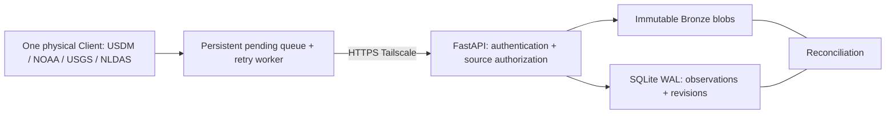

# Climate Data Lake Server ? Stage 1.5

**1 CLIENT ? 1 SERVER.** M?t physical Collector g?i USDM, NOAA, USGS v? NASA NLDAS
qua HTTPX; Server x?c th?c, ph?n quy?n, gi? raw Bronze b?t bi?n v? ghi SQLite registry.
Ch?a tri?n khai Historical Replay, downloader th?t ho?c Silver/Gold trong giai ?o?n n?y.



## C?i ??t tr?n Windows

Python 3.11/3.12, filesystem c?c b?. N?u clone m?i, ??t hai repo c?nh nhau:

```powershell
git clone https://github.com/phamquocanh149/IT5425_DataLakeHouse_Server.git climate-platform
git clone https://github.com/phamquocanh149/IT5425_DataLakeHouse_Client.git climate-collector
cd climate-platform
py -3.11 -m venv .venv
.\.venv\Scripts\python.exe -m pip install -r requirements.txt
# Ch? copy n?u ch?a c? .env; kh?ng ghi ?? c?u h?nh c?.
if (!(Test-Path .env)) { Copy-Item .env.example .env }
```

?i?n `COLLECTOR_API_KEY` v? `ADMIN_API_KEY` b?ng hai secret kh?c nhau, kh?ng d?ng gi? tr?
placeholder. Collector key ?nh x? sang `collector01`; Admin ch? qu?n tr?/xem metadata,
kh?ng d?ng ?? upload. Client ch? nh?n Collector key. Kh?a tr?ng b? v? hi?u h?a;
kh?a tr?ng ho?c placeholder khi?n Server t? ch?i c?u h?nh. Kh?ng commit `.env`.
Bi?n m?i tr??ng ?u ti?n h?n `.env`; n?u m?y c? `DEBUG=release`, ??t `$env:DEBUG='False'`.

```powershell
$env:DEBUG='False'
.\.venv\Scripts\python.exe -m uvicorn server.main:app --host 127.0.0.1 --port 8000
```

L?nh Uvicorn quy?t ??nh bind/port; `SERVER_HOST` trong `.env` kh?ng t? ??i tham s? CLI.
Kh?ng t? m? port, ??i Firewall, bind `0.0.0.0` ho?c c?i d?ch v? h? ?i?u h?nh.

## Authentication, authorization v? API

- Collector: upload b?n source trong `COLLECTOR_SOURCES`; ch? xem b?n ghi thu?c danh t?nh
  c?a m?nh v? source ???c c?p quy?n. Kh?ng th? g?i form `client_id` ?? gi? m?o danh t?nh.
- Admin: xem m?i b?n ghi, g?m d? li?u l?ch s? `client01/client02` v? tr?ng th?i recovery.
- Kh?a thi?u/sai: 401. Kh?a ??ng nh?ng kh?ng ???c ph?p: 403. CORS m?c ??nh kh?ng m?.
- `ENABLE_LEGACY_KEYS=False` m?c ??nh. Khi chuy?n ??i c? th? b?t r? r?ng ?? cho kh?a c?
  ho?t ??ng: client01 ch? USDM/NOAA, client02 ch? USGS/NLDAS. Kh?ng s?a client_id l?ch s?.

| Endpoint | Contract |
|---|---|
| GET /health | Public: status=ok, service=climate-data-server |
| POST /upload | X-API-Key; multipart file, source, source_date; dataset_key t?y ch?n |
| GET /uploads | X-API-Key; filter source t?y ch?n; l?c theo quy?n |

Field c? v? HTTP 200 `VERIFIED` / `DUPLICATE` gi? nguy?n. Response metadata th?m
`dataset_key`, `revision`, `previous_file_id`, `is_current`, `error_message`.
`VERIFIED` x?c nh?n Bronze + registry ?? commit, kh?ng c? ngh?a Silver/Gold ?? x? l?.
Chi ti?t: [API contract](docs/API_CONTRACT.md).

## Identity, revision v? l?u tr?

- Physical content identity: SHA-256. C?ng n?i dung d?ng l?i blob v?t l? sau ki?m tra hash.
- Logical identity: `(source, source_date, dataset_key, sha256)` c? UNIQUE constraint.
- `dataset_key` ?n ??nh theo s?n ph?m/tr?m/ch? s?; thi?u th? d?ng basename g?c (ch?a sanitize).
  Tr??ng n?y l? metadata, kh?ng ???c d?ng ?? x?y ???ng d?n raw.
- Kh?c ng?y/source/key t?o observation m?i d? hash gi?ng nhau. ??i n?i dung t?o revision,
  li?n k?t version tr??c; ch? m?t revision `is_current=1`. G?i l?i revision c? tr? DUPLICATE
  c?a revision ??, kh?ng ??a n? th?nh current.
- Dataset thu?c danh t?nh kh?c b? 403, tr?nh l? metadata qua duplicate. Khi th?m Collector
  m?i c?n c?p ngu?n/namespace dataset ph? h?p, kh?ng t? nh?n ownership c?a l?ch s?.

Raw m?i: `data_lake/bronze/<source ??u ti?n>/sha256=<hash>/payload`. T?n g?c n?m trong
registry. Blob chia s? gi?a observation; ???ng d?n c? th? thu?c source c?a l?n g?i ??u.
Raw c? gi? nguy?n ???ng d?n. Registry: `metadata/ingestion.sqlite3`, schema version 1,
b?ng `content_blobs`, `observations`, `recovery_reports`; WAL, synchronous FULL,
transaction BEGIN IMMEDIATE v? unique indexes ch?ng race. Kh?ng ??t SQLite tr?n SMB/NFS.
Gi?i h?n m?c ??nh **20 MiB**, hash/copy theo chunk, kh?ng load nguy?n file v?o RAM.

## Migration v? recovery

D?ng nh?n upload trong l?c chuy?n ??i l?n ??u ?? ki?m tra k?t qu? r? r?ng:

```powershell
.\.venv\Scripts\python.exe scripts/migrate_metadata.py
.\.venv\Scripts\python.exe scripts/reconcile_storage.py --checksum
# T?y ch?n: ch? s?a tr?ng th?i DB sau ki?m tra, kh?ng s?a/x?a raw.
.\.venv\Scripts\python.exe scripts/reconcile_storage.py --checksum --repair-status
```

Migration backup m?i JSON ngu?n trong `metadata/backups/<timestamp-id>/`, ki?m tra file,
size/hash, import transactional, c? th? ch?y l?i. Gi? JSON v? file raw; b?o c?o l?i/thi?u
file, kh?ng suy ?o?n observation b? thi?u. SQLite l? source of truth cho metadata m?i.
D? li?u c? ch?a migrate s? kh?ng xu?t hi?n trong GET /uploads.

Reconciliation ph?t hi?n temporary files, orphan Bronze, missing/corrupt/unsafe paths;
l?u b?o c?o v?o SQLite. `--repair-status` ch? ??nh d?u MISSING/CORRUPT ho?c kh?i ph?c VERIFIED
sau khi file th?c t? kh?p. Kh?ng t? x?a temp (c? th? ?ang upload), kh?ng t? g?n metadata
cho orphan. Retry upload c? th? nh?n l?i orphan ??ng hash v? commit observation an to?n.
N?u registry l?i sau ghi raw, request kh?ng tr? VERIFIED; file raw c?n ?? ph?c h?i.
Exit code 1 c?a maintenance cho bi?t c? l?i/b?t nh?t c?n xem b?o c?o.

## Tests v? demo

```powershell
$env:DEBUG='False'
.\.venv\Scripts\python.exe -m pytest -q
# Ch? unit tests:
.\.venv\Scripts\python.exe -m pytest tests/test_server.py tests/test_stage15.py -q
# Ch? HTTP integration (c?n repo Client c?nh Server ho?c CLIENT_REPO_PATH):
$env:CLIENT_REPO_PATH=(Resolve-Path ..\climate-collector).Path
.\.venv\Scripts\python.exe -m pytest tests/integration -q
```

Integration b?t bu?c d?ng Uvicorn subprocess v? HTTP loopback th?t: A upload, B duplicate,
C kh?c ng?y, D offline/restart/worker, E c? b?n ngu?n, F hai Client process ??ng th?i.
M?i storage/DB/credentials l? test ri?ng, kh?ng d?ng d? li?u c?a ng??i d?ng.
Xem [demo 5?7 ph?t](docs/STAGE_1_5_DEMO.md) v? [b?o c?o ki?m th?](docs/VALIDATION.md).

## Hai m?y Windows qua Tailscale

Gi? Uvicorn ? 127.0.0.1. Sau khi hai m?y ? c?ng tailnet v? ???c c?p quy?n truy c?p,
ng??i v?n h?nh b?t HTTPS certificates c?a tailnet v? ch?y tr?n Server:

```powershell
tailscale serve --bg 8000
```

Client d?ng URL HTTPS do l?nh tr? v?, kh?ng d?ng localhost c?a m?y Client; kh?ng d?ng
Admin key, kh?ng t?t TLS verification. Windows c? th? c?n terminal Administrator ??
ch?y Serve. Ch? h??ng d?n, t?c v? n?y kh?ng t? th?c thi c?u h?nh m?ng. Tham kh?o
[Tailscale Serve](https://tailscale.com/docs/reference/tailscale-cli/serve) v?
[v? d? Windows](https://tailscale.com/docs/reference/examples/serve).

## Gi?i h?n v? b??c ti?p theo

Demo d?ng m?t Server process, SQLite local, t?c v? filesystem/registry ??ng b? c? th?
ch?n event loop trong th?i gian ng?n; GET /uploads ch?a ph?n trang. Worker Client tu?n t?,
kh?ng ph?i Windows Service. Reconciliation b?o c?o an to?n, kh?ng kh?i ph?c bytes b? m?t.
Schema v1 ch?a c? migration t?i version t??ng lai; version l? b? t? ch?i.
Ch?a ki?m th? tr?n hai m?y v?t l? ho?c qua Tailscale. JSON l?ch s? tr?n m?y n?y ch?a ???c
migrate t? ??ng v? kh?a local ch?a t? chuy?n ??i. C?n v?n h?nh migration v? c?p Collector key.

Stage 2: b? sung Historical Replay v?i dataset_key ?n ??nh, checkpoint theo t?ng ngu?n,
v? live collectors. Stage 3: ??c observation current/VERIFIED ?? t?o Silver/Gold trong
pipeline ri?ng; kh?ng s?a Bronze. Hai stage n?y ch?a ???c tri?n khai trong nhi?m v? n?y.
